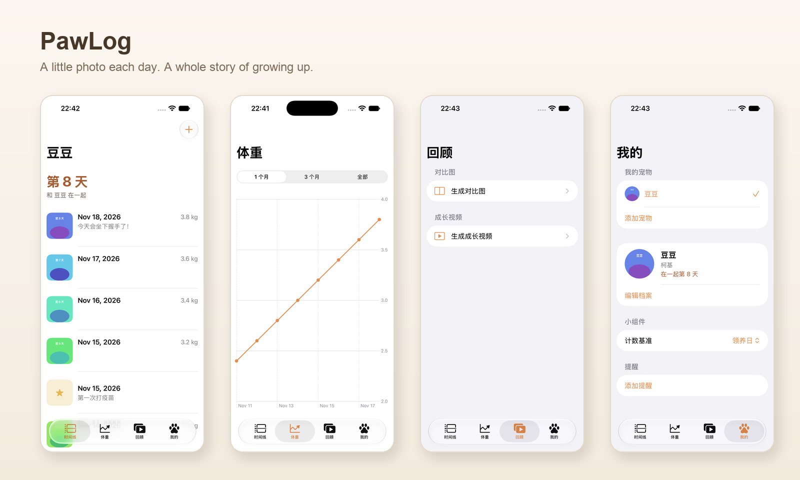

<div align="center">

# PawLog — iOS Pet Growth Journal

**A little photo each day. A whole story of growing up.**

A local-first iOS app for new pet parents: photo journaling, aligned before-and-after photography, weight charts, milestones, and automatically generated keepsakes.

**[English](README.md) · [简体中文](README.zh-CN.md) · [Product Landing Page](https://wandering-queen-f8fa.caojunjia040721.workers.dev)**

[](https://developer.apple.com/ios/)
[](https://www.swift.org/)
[](https://developer.apple.com/swiftui/)
[](#architecture)
[](#status-and-limitations)

[Overview](#overview) · [Features](#features) · [Architecture](#architecture) · [Build](#build) · [Verification](#verification) · [Status](#status-and-limitations)

</div>

---



<a id="overview"></a>
## 1. Overview

PawLog is a growth time capsule for the first twelve months with a puppy or kitten. It is built around a simple emotional loop: spend roughly 30 seconds making a record today, then rediscover that change over time through aligned photographs, charts, and shareable retrospectives.

The app's distinguishing interaction is **comparison-mode photography**. The previous photo appears as a translucent overlay in the camera or photo-picker flow, helping the user capture the next image from a similar angle.

PawLog is deliberately local-first. Version 1 requires no account, backend, subscription, or third-party SDK.

<a id="features"></a>
## 2. Product Features

| Capability | Delivered behavior |
|---|---|
| **Multiple pet profiles** | Name, breed, birthday, adoption date, and photo; switch between pets across all tabs |
| **Photo journal** | Camera or photo-library records, optional weight and notes, one record per day, and backdating with overwrite warnings |
| **Aligned comparison capture** | Previous-photo overlay with adjustable opacity; simulator-friendly photo-picker fallback |
| **Weight history** | Swift Charts line chart with one-month, three-month, and all-time ranges |
| **Milestones and reminders** | Timeline milestones plus local vaccination and deworming notifications |
| **Before-and-after cards** | Select two records and generate a dated, age-labelled comparison image for saving or sharing |
| **Growth videos** | Chronological portrait video with date captions, export progress, album saving, and system sharing |
| **Home-screen widget** | Pet image and “day N together” counter with selectable birthday or adoption-date basis |
| **Local privacy** | SwiftData and local photo storage; no server, analytics SDK, or third-party dependency |

<a id="architecture"></a>
## 3. Architecture

```text
SwiftUI views
│
├── AppStore and SwiftData models
│   ├── Pet profiles
│   ├── Daily records and milestones
│   └── Reminders and widget settings
│
├── Local device services
│   ├── PhotoStore for image files
│   ├── UserNotifications for reminders
│   ├── AVAssetWriter for frame-by-frame video export
│   └── PhotoLibrarySaver and system ShareSheet
│
└── PawLogWidget
    ├── WidgetKit timeline and PetWidgetEntryView
    └── Shared settings through an App Group, with local fallback
```

**Stack:** Swift 6, SwiftUI, SwiftData, Swift Charts, WidgetKit, AVFoundation, PhotosUI, UserNotifications, and XcodeGen. Strict concurrency and MainActor-default isolation are enabled in `project.yml`.

## 4. Build and Run

### Requirements

- Xcode with an **iOS 26 SDK or newer**
- [XcodeGen](https://github.com/yonaskolb/XcodeGen)
- An iPhone Simulator for the standard build; a physical device for camera validation

```bash
git clone https://github.com/Cjj040721/PawLog-iOS-Pet-Growth-Journal.git
cd PawLog-iOS-Pet-Growth-Journal
xcodegen
open PawLog.xcodeproj
```

`project.yml` is the source of truth. `PawLog.xcodeproj` is generated locally and is not committed. Run `xcodegen` after pulling changes or adding, removing, or moving source files.

Command-line build:

```bash
xcodebuild -scheme PawLog \
  -destination 'platform=iOS Simulator,name=iPhone 17' \
  build
```

### Demo data

The debug app supports two launch arguments:

- `-seedDemoData` — seed the demo pet and eight days of records.
- `-initialTab N` — open timeline `0`, weight `1`, review `2`, or profile `3`.

The README screenshots use these arguments on an iPhone 17 Simulator. The coloured demo placeholders are seeded content, not stock pet photographs.

<a id="verification"></a>
## 5. Verification

| Check | Current evidence |
|---|---|
| Simulator build | **Passed with 0 warnings** on the current Xcode toolchain |
| Release archive | Run without code signing as the final project check; see the result recorded in `LEDGER.md` |
| Physical-device workflow | Camera comparison mode, photo saving, backdating, growth-video export, album saving, and sharing were checked on 31 July 2026 |
| README visuals | Four real Simulator screens captured from the current build |

The project currently has no test target. Its documented release gate is a zero-warning Simulator build and archive, supplemented by Simulator walkthroughs and physical-device checks.

## 6. Repository Structure

```text
PawLog-iOS-Pet-Growth-Journal/
├── PawLog/
│   ├── App/                  # App entry and root state
│   ├── ViewModels/           # Application state
│   ├── Views/                # Timeline, capture, weight, review, profile, and onboarding
│   └── Services/             # Camera, video, photo library, notifications, and demo data
├── Shared/
│   ├── Models/               # SwiftData models
│   ├── Data/                 # Persistence, photos, and shared settings
│   ├── Utilities/            # Dates and design tokens
│   └── Widget/               # Shared widget views
├── PawLogWidget/             # WidgetKit extension
├── design/                   # Design language and token preview
├── docs/                     # README hero and real Simulator screenshots
├── landing/                  # Product landing page
├── product-spec.md           # Given/When/Then acceptance criteria
├── market-research.md        # Product and market research
├── project.yml               # XcodeGen project definition
└── LEDGER.md                 # Implementation and verification record
```

<a id="status-and-limitations"></a>
## 7. Status and Limitations

PawLog is a **pre-release v1**, not currently listed on the App Store. The full v1 feature set has been implemented, with physical-device validation and interaction polish recorded in the project ledger.

- The Simulator does not provide a physical camera; capture falls back to photo selection with overlay preview.
- Full App Group widget sharing on a physical device requires the appropriate Apple Developer entitlement; the app includes a local-storage fallback for Personal Team limitations.
- Version 1 does not include social features, medical advice, e-commerce, CloudKit sync, AI features, or in-app purchases.
- CloudKit sync is a possible v1.1 direction; subscriptions are deferred to v1.2 planning.

## 8. Documentation and Author

- [Product specification](product-spec.md)
- [Market research](market-research.md)
- [Design language](design/design-language.md)
- [Implementation and verification ledger](LEDGER.md)
- [Chinese project overview](README.zh-CN.md)

Designed and built by **Cao Junjia**.

---

<div align="center">

**PawLog — Keep the days. See the growth.**

Swift 6 · SwiftUI · SwiftData · WidgetKit · Local-first

</div>
